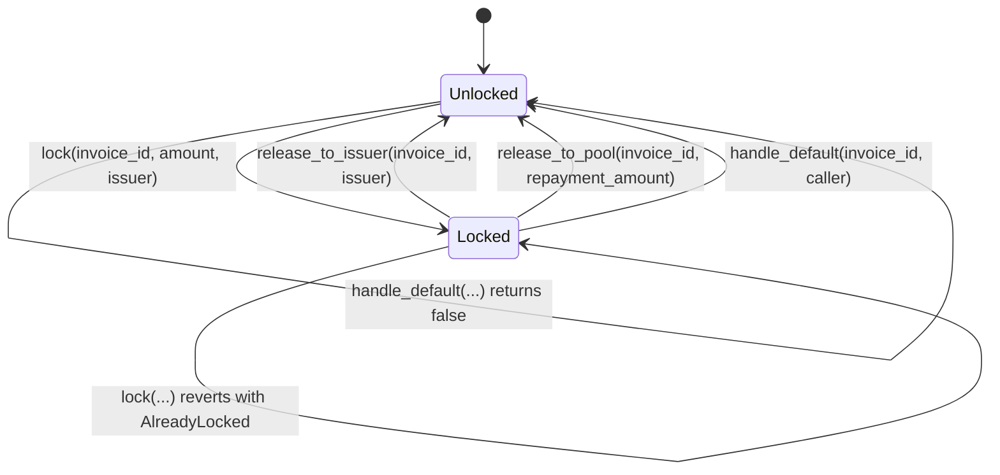
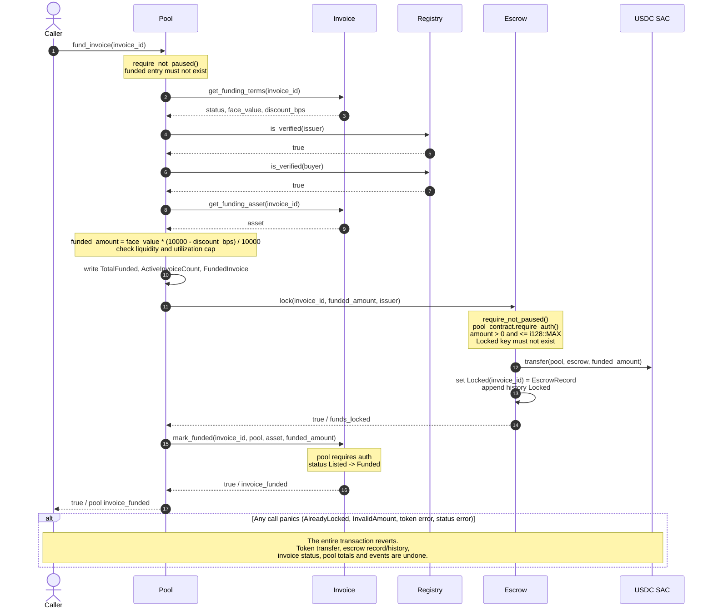
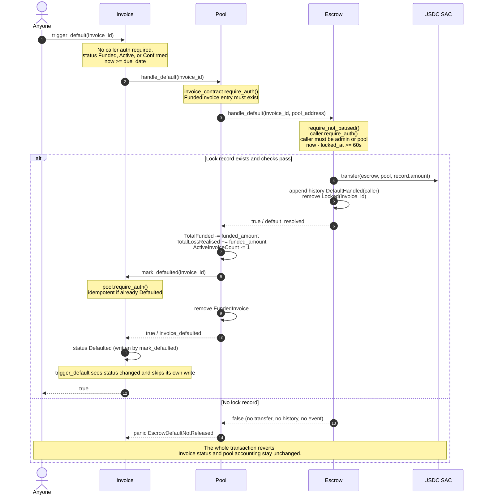

# Escrow Custody and Recovery Paths

> **Testnet only.** ClearLedger is a Stellar testnet prototype. Mainnet
> deployment is not supported, there is no formal audit, and nothing in this
> document is a Mainnet guarantee. See the repository
> [limitations](../../docs/LIMITATIONS.md) and
> [threat model](../../docs/THREAT_MODEL.md).

This page describes how the escrow contract takes custody of USDC, how that
custody is released on repayment and default, which address must authorize
each step, and what happens when a step fails. It reflects the code in this
checkout, not earlier design notes. Where the current implementation does not
match the intended flow, the gap is called out explicitly.

**Source files**

- [`src/lib.rs`](./src/lib.rs) — entry points and storage transitions
- [`src/types.rs`](./src/types.rs) — `EscrowRecord`, `EscrowEvent`, `DataKey`
- [`src/events.rs`](./src/events.rs) — emitted event topics and data
- [`src/errors.rs`](./src/errors.rs) — `EscrowError` codes

## Participants and custody model

| Participant | Role in escrow |
| --- | --- |
| Caller / LP | Permissionlessly triggers `pool.fund_invoice`; does not authorize escrow directly. |
| Buyer | Authorizes `invoice.repay`, `invoice.repay_partial`, and `invoice.repay_early`; funds enter escrow from the buyer's wallet. |
| Invoice issuer | Receives escrow funds only through `escrow.release_to_issuer`; must match the `issuer` stored at lock time. Not the USDC asset issuer. |
| Pool | Holds LP liquidity. The **only** contract authorized to call `lock`, `release_to_issuer`, and `release_to_pool`; may also call `handle_default`. |
| Invoice contract | Orchestrates buyer repayment and permissionless default handling; is the `invoice_contract` wired into the pool. |
| Escrow contract | Custody address. Holds USDC between funding and release; has no arbitrary-withdraw entry point. |
| USDC SAC | The configured Stellar Asset Contract for USDC. All movement uses its `transfer` entry point. The asset issuer's trustline rules live outside escrow. |
| Admin | Can `pause`/`unpause`, `upgrade`, and call `handle_default` as an alternative recovery caller. |

USDC amounts are `u128` stroops (7 decimal places). Each escrow transfer path
checks the amount is non-zero and `<= i128::MAX` before converting to `i128`;
invalid escrow amounts revert with `InvalidAmount` (`#5`). Transfers initiated
by the invoice or pool contracts apply their own validation.

The escrow contract itself never calls `require_auth` on the buyer or the
invoice issuer. It authenticates the **configured pool** (or, for
`handle_default`, the pool or admin) and relies on the pool/invoice contracts
for user-level authorization.

## Authorization matrix

| Entry point | Required authorization | Additional checks |
| --- | --- | --- |
| `initialize(admin, pool_contract, usdc_asset)` | `admin` | Not already initialized; all three addresses distinct. |
| `lock(invoice_id, amount, issuer)` | `pool_contract` | Not paused; amount non-zero and `<= i128::MAX`; invoice not already locked. |
| `release_to_issuer(invoice_id, issuer)` | `pool_contract` | Not paused; lock exists; recipient is neither escrow nor pool; recipient equals the stored `issuer`. |
| `release_to_pool(invoice_id, repayment_amount)` | `pool_contract` | Not paused; amount non-zero and `<= i128::MAX`; lock exists. |
| `handle_default(invoice_id, caller)` | `caller`, which must be `admin` or `pool_contract` | Not paused; if a lock exists, at least `DEFAULT_MIN_LOCK_SECONDS` (60s) must have elapsed since `locked_at`. Returns `false` when no lock exists. |
| `pause()` / `unpause()` | `admin` | `unpause` is intentionally not pause-guarded. |
| `upgrade(new_wasm_hash)` | `admin` | — |
| `get_locked`, `get_locked_at`, `get_history`, `get_usdc_asset`, `get_admin`, `get_pool_contract` | None | Read-only; remain callable while paused. |

The pool obtains its authorization by invoking escrow. For example, in
`pool.fund_invoice`, the pool calls `escrow.lock`; because the pool is the
invoking contract, its `require_auth` is satisfied within that call tree. The
invoice contract similarly authenticates itself to the pool when calling
`pool.receive_repayment*` and `pool.mark_defaulted`.

> **Repayment authorization caveat (current checkout).** `release_to_pool`
> calls `require_pool_auth()`, so the configured pool must authorize the call.
> The buyer repayment path (`invoice.repay_partial` / `repay_early`) invokes
> `escrow.release_to_pool` **directly from the invoice contract**, which does
> not place the pool in that call tree. The repository's repayment tests use
> `mock_all_auths_allowing_non_root_auth`, so they do not prove this direct
> invoice → escrow call under real signatures. Treat the pool-auth requirement
> above as authoritative and do not assume a buyer can satisfy it on a live
> network. See [Current-checkout caveats](#current-checkout-caveats).

## Storage and state machine

Instance storage:

- `Admin`, `PoolContract`, `UsdcAsset`
- `PauseState::Paused` (shared `clearledger-pause` crate)

Persistent storage per invoice:

- `Locked(invoice_id) -> EscrowRecord { invoice_id, amount, locked_at, issuer }`
- `History(invoice_id) -> Vec<EscrowEvent>`

Both persistent entries have their TTL extended on every write. There is no
`InvoiceContract` key in escrow storage in this checkout; the escrow contract
does not store the invoice address.



`lock` writes the `EscrowRecord`, appends a `Locked` history entry, and emits
`funds_locked`. Every release path appends a history entry and **removes** the
`Locked` key. After removal, `get_locked` and `get_locked_at` return `0`, and a
second release for the same invoice reverts with `NotFound` (`#2`).

## Funding path

`pool.fund_invoice(invoice_id)` is permissionless. The pool is the escrow
caller, so no end-user escrow authorization is required.



Post-funding custody: escrow holds `funded_amount` and the `Locked` record
contains the invoice issuer authorized to receive it. Funding does **not**
automatically pay the issuer; `release_to_issuer` is a separate call and is not
currently invoked by `pool.fund_invoice` (see [gaps](#current-checkout-caveats)).

### Issuer release (manual, not wired)

Only the configured pool can release to the invoice issuer. The call:

1. Reverts with `NotInitialized` (`#6`) if the pool is not configured, fails
   the host authorization check if the pool does not authorize the call, and
   reverts with `ContractPaused` while paused.
2. Rejects the escrow address, the pool address, or any address that is not the
   `issuer` stored in the `Locked` record (`InvalidRecipient`, `#7`).
3. Transfers the full `record.amount` from escrow to that issuer via the USDC
   SAC.
4. Appends `ReleasedToIssuer`, removes `Locked(invoice_id)`, and emits
   `released_to_issuer` with topics `(invoice_id, issuer)` and data `amount`.

Any panic reverts the transfer, history append, record removal, and event. Once
this succeeds the lock is consumed; a later `release_to_pool` for the same
invoice reverts with `NotFound`.

## Repayment path

There are two shapes:

1. **Partial installment** — `invoice.repay_partial(invoice_id, amount)` moves
   buyer USDC into escrow and leaves the lock record untouched. The invoice
   tracks `repaid_amount` / `remaining_balance` and emits
   `partial_repayment_received`.
2. **Final settlement** — the remaining balance is paid, then
   `escrow.release_to_pool` moves the **full `face_value`** back to the pool,
   and the pool books repayment. `invoice.repay` is a wrapper that pays the
   entire remaining balance; `invoice.repay_early` does the same with an
   early-repayment gate and a time-proportional refund.

```mermaid
sequenceDiagram
    autonumber
    actor Buyer
    participant Invoice
    participant Escrow
    participant Pool
    participant Treasury
    participant USDC as USDC SAC

    Buyer->>Invoice: repay(invoice_id) or repay_partial(invoice_id, amount)
    Note over Invoice: buyer.require_auth()<br/>status Funded, Active, or Confirmed<br/>0 < amount <= remaining_balance
    Invoice->>USDC: transfer(buyer, escrow, amount)
    alt Partial installment (new remaining > 0)
        Invoice->>Invoice: update repaid_amount and remaining_balance<br/>keep status
        Invoice-->>Buyer: true / partial_repayment_received
        Note over Escrow: No escrow release, history entry, or event.<br/>Buyer funds accumulate in escrow.
    else Final installment (new remaining == 0)
        Invoice->>Escrow: release_to_pool(invoice_id, face_value)
        Note over Escrow: require_not_paused()<br/>pool_contract.require_auth()<br/>amount > 0 and <= i128::MAX<br/>Locked record must exist
        Escrow->>USDC: transfer(escrow, pool, face_value)
        Escrow->>Escrow: append history ReleasedToPool<br/>remove Locked(invoice_id)
        Escrow-->>Invoice: true / released_to_pool
        Invoice->>Pool: receive_repayment_with_refund(invoice_id, face_value, refund, buyer)
        Note over Pool: invoice_contract.require_auth()<br/>amount >= funded_amount<br/>refund <= amount - funded_amount
        opt protocol_cut > 0
            Pool->>USDC: transfer(pool, treasury, protocol_cut)
        end
        opt refund > 0
            Pool->>USDC: transfer(pool, buyer, refund)
        end
        Pool->>Pool: update TotalDeposits, TotalYieldDistributed, TotalFunded,<br/>ActiveInvoiceCount; remove FundedInvoice
        Pool-->>Invoice: true / repayment_received
        Invoice->>Invoice: status Repaid, repaid_at, remaining_balance = 0
        Invoice-->>Buyer: true / invoice_repaid
    end
    alt Any call panics (auth, NotFound, InvalidAmount, token error, pool accounting)
        Note over Buyer,USDC: The entire transaction reverts.<br/>Buyer transfer, escrow transfer/removal,<br/>pool totals/refund and invoice state are undone.
    end
```

### Custody arithmetic and the current settlement gap

Assume no prior issuer release, so escrow still holds the original lock `F`,
where `F = funded_amount` and `face_value = F + D` (`D` is the discount).
The current final-settlement path does this:

1. Buyer transfers `F + D` into escrow. Escrow balance becomes `2F + D`.
2. Escrow transfers `face_value = F + D` to the pool. Escrow balance becomes `F`.
3. The `Locked` record is removed even though `F` remains in escrow.

Because the lock record is gone, no escrow entry point can move that remaining
`F` afterwards: every release path requires an existing record. There is also
no sweep/rescue function for unrecorded balances. In addition,
`release_to_pool` accepts any non-zero `repayment_amount` and does **not** cap
it at the recorded lock amount, so an over-release can spend custody belonging
to other invoices.

If `release_to_issuer` was called first, the `Locked` record is already gone
and the later `release_to_pool` reverts with `NotFound`. In this checkout the
issuer-release workaround and the buyer repayment route are therefore mutually
exclusive.

## Default and recovery path

`invoice.trigger_default(invoice_id)` is permissionless once
`now >= due_date`. The invoice contract forwards to the pool, which forwards to
escrow. The pool is the escrow caller, so the pool must be the configured
pool contract.



The 60-second grace period is independent of the invoice's due-date gate. If
`due_date` is reached less than 60 seconds after the escrow was funded, the
downstream `handle_default` reverts with `NotAuthorized` (`#3`), and the whole
`trigger_default` transaction reverts until `locked_at + 60s`. This coupling is
documented on `EscrowContract::handle_default` and
`InvoiceContract::trigger_default`.

### Emergency admin recovery

The stored admin may call `escrow.handle_default(invoice_id, admin)` directly,
without going through the invoice or pool. This transfers `record.amount` from
escrow to the configured pool, appends `DefaultHandled` with `caller = admin`,
removes the lock, and emits `default_resolved`.

This path does **not** update the invoice status or the pool's
`FundedInvoice` / `TotalFunded` / loss accounting, because it bypasses both
contracts. It is an emergency token-recovery path, not a full default
settlement; subsequent normal default processing will see no escrow lock and
`pool.handle_default` will revert with `EscrowDefaultNotReleased`.

## Rollback behavior

Soroban executes a contract invocation atomically. Any panic or failed
cross-contract call unwinds the entire transaction, including nested contract
calls, token transfers, storage writes, and published events. There is no
partial state to repair after a failed funding, repayment, or default call.

| Failure | Error surfaced | Effect after revert |
| --- | --- | --- |
| Escrow paused | `ContractPaused` (shared pause error `#1`) | No token movement or storage change. |
| Not initialized | `NotInitialized` (`#6`) | No token movement or storage change. |
| `lock` on an already-locked invoice | `AlreadyLocked` (`#4`) | Existing lock and balance unchanged. |
| Zero or oversized amount | `InvalidAmount` (`#5`) | No token movement. |
| `release_to_issuer` to wrong recipient | `InvalidRecipient` (`#7`) | Lock remains; no token movement. |
| Release/default for unknown invoice | `NotFound` (`#2`) or `handle_default` returns `false` | No token movement; pool turns `false` into a panic. |
| Default caller not admin/pool | `NotAuthorized` (`#3`) | Lock remains; no token movement. |
| Default before 60s grace | `NotAuthorized` (`#3`) | Lock remains; invoice default transition reverts. |
| Token transfer failure | Token contract error | All escrow, pool, invoice, and token state reverts. |
| Pool or invoice accounting failure | Pool/Invoice error | All prior cross-contract work reverts. |

## Events

Event payloads are defined in [`src/events.rs`](./src/events.rs). Topics are
`(Symbol, ...)` and data is the value in the final column.

| Event | Topics | Data |
| --- | --- | --- |
| `funds_locked` | `"funds_locked"`, `invoice_id`, `issuer` | `amount` (`u128`) |
| `released_to_issuer` | `"released_to_issuer"`, `invoice_id`, `issuer` | `amount` (`u128`) |
| `released_to_pool` | `"released_to_pool"`, `invoice_id`, `pool` | `amount` (`u128`) |
| `default_resolved` | `"default_resolved"`, `invoice_id`, `pool`, `caller` | `amount` (`u128`) |
| `paused` | `"paused"`, `admin` | `()` |
| `unpaused` | `"unpaused"`, `admin` | `()` |
| `upgraded` | `"upgraded"`, `wasm_hash` | `()` |

History (`History(invoice_id)`) records `EscrowAction::{Locked,
ReleasedToIssuer, ReleasedToPool, DefaultHandled}` with amount, timestamp, and
an optional `caller` populated only for `DefaultHandled`.

## Pause and recovery operations

`pause` and `unpause` are admin-only. While paused, `initialize`, `lock`,
`release_to_issuer`, `release_to_pool`, and `handle_default` revert with
`ContractPaused`; read-only views remain available. `unpause` is deliberately
not guarded so a paused escrow can always be resumed. Pausing does not move or
unlock funds, and the existing `Locked` records stay intact.

## Current-checkout caveats

These are properties of the code in this checkout, not Mainnet guarantees:

- **Issuer release is not wired.** No contract calls `release_to_issuer`; it is
  an externally triggered call. See Issue #56 in the repository
  [limitations](../../docs/LIMITATIONS.md#issuer-release-not-wired-issue-56).
- **Issuer release and buyer repayment are mutually exclusive.** Both consume
  the single `Locked` record; the second path reverts with `NotFound`.
- **Final repayment removes the lock while the original principal remains in
  escrow** (see [custody arithmetic](#custody-arithmetic-and-the-current-settlement-gap)).
  There is no sweep function for that residual balance.
- **`release_to_pool` is not bounded by the lock amount.** It can release more
  than `record.amount` and draw down custody for other invoices.
- **Direct invoice → escrow repayment needs pool authorization.** The
  requirement is enforced by `release_to_pool`, but the buyer path calls it
  directly and the tests mock authorization. This is not proven on a live
  network.
- **Partial repayments are held in escrow without escrow accounting.** A
  default only returns `record.amount`; buyer installments already sent to
  escrow are not included in that transfer and remain unattributed.
- **Admin emergency recovery bypasses invoice and pool accounting.** It moves
  tokens but leaves the invoice status and pool's funded/loss records stale.
- **No audit, no Mainnet support.** Testnet deployments only.

## Related documentation

- [Escrow README](./README.md)
- [Repository README — escrow contract](../../README.md#escrow_contract)
- [Event catalog — Escrow Contract](../../docs/EVENTS.md#escrow-contract)
- [Storage schema — escrow_contract](../../docs/STORAGE.md#contract-escrow_contract)
- [Threat model — authentication gates](../../docs/THREAT_MODEL.md#authentication-gates)
- [Limitations](../../docs/LIMITATIONS.md)
